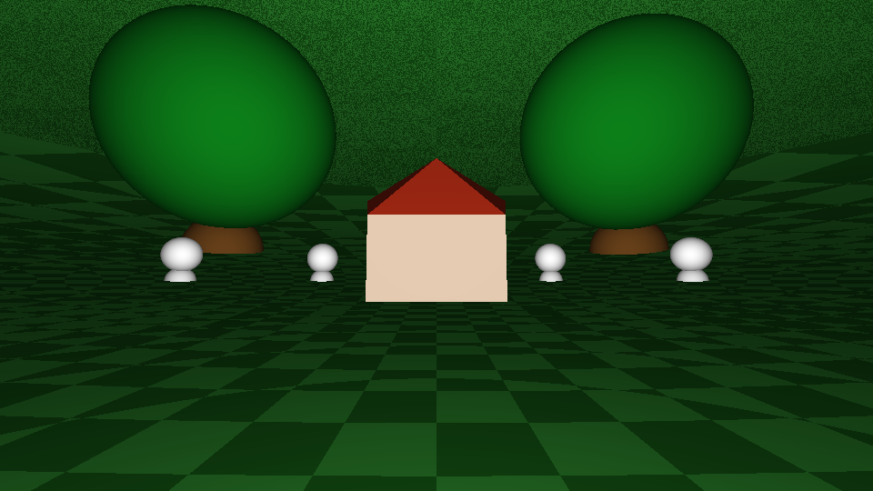
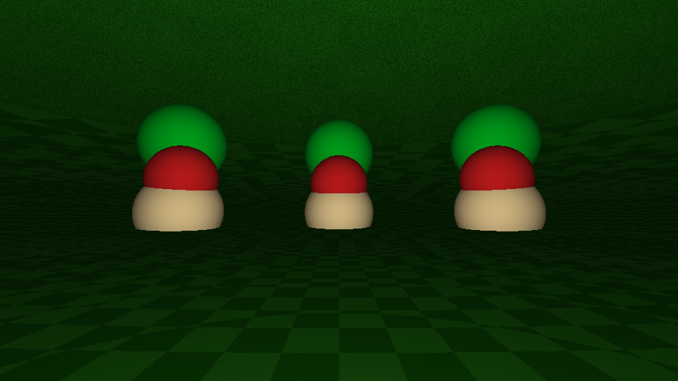
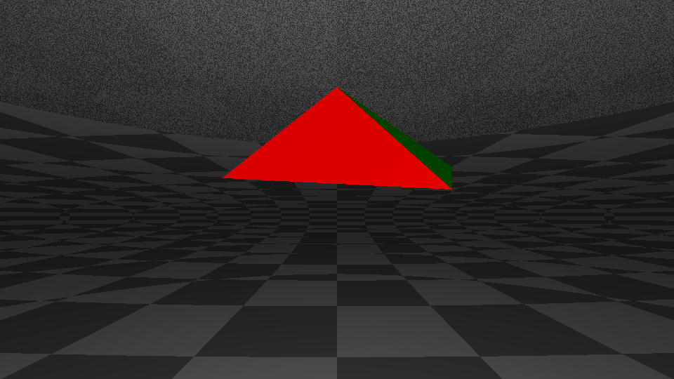

# CurvedSpaceSim

A real-time ray tracer for **curved space**. Instead of rendering a flat 3D world, it renders the inside of the 3-sphere **S³**, a closed universe where walking in a straight line eventually brings you back to where you started. It is written in plain Java with no external libraries, and the math is implemented from scratch.

<p align="center">
  
</p>

<p align="center">
  
  
</p>

## What is S³?

S³ is the set of unit vectors in four-dimensional space, `x² + y² + z² + w² = 1`. It is the 3D analogue of the surface of a ball. It is finite but has no edge, and "straight lines" (geodesics) are great circles. In a world like this:

- the horizon bends: ground that is "flat" at your feet curves back up around you,
- parallel lines meet,
- the ground in the ground scenes is a great sphere whose far side is the point opposite you,
- looking far enough in any direction shows the back of your own head.

## How it works

Each pixel casts a geodesic ray `P(t) = O·cos t + D·sin t` instead of a straight line `O + t·D`, and the renderer solves for where it hits each object **analytically**:

| Component | Idea |
|---|---|
| `geometry/S3Space` | Geodesic distance is `acos(p·q)`. Tangent-space projection via Gram–Schmidt. |
| `tracer/Camera` | Builds a 3D tangent frame at a point on S³. The "right" vector comes from a **generalized 4D cross product** of position, forward and up. Moving forward is rotation in the plane of position and direction. |
| `tracer/GroundCamera` | Camera that keeps a constant height above the ground sphere and parallel-transports its frame as it walks. |
| `tracer/Sphere` | A spherical cap on S³. Ray intersection reduces to `A·cos t + B·sin t = cos ρ`, solved in closed form. |
| `tracer/S3Triangle` | Geodesic triangle (flat in the 3-plane through its vertices) tested with edge-plane normals, giving walls, roofs and pyramids. |
| `tracer/RayTracer` | Multi-threaded per-scanline renderer with headlight Lambert shading. |
| `math/` | `Vec3`, `Vec4`, `Mat4` written from scratch. |

There is also a small **S² visualizer** (`s2/`), a 2D warm-up for the geometry. It draws geodesic rays fanning out across a sphere, so you can see how "straight" paths behave on a curved surface.

## Running it

Requires **JDK 21**.

```bash
./gradlew run                                             # S³ ray tracer
./gradlew run -PmainClass=com.curvedspace.s2.S2Main      # S² geodesic visualizer
```

### Controls

| Input | Action |
|---|---|
| `W` / `S` | Move forward / backward along a geodesic |
| `A` / `D` | Turn left / right |
| Mouse drag, `↑` / `↓` | Look around |
| `1`–`6` | Switch scene: Hypercube, Earth, Infinite Earth, City, Pyramid, Triangle House |
| `P` | Save a screenshot |

### Headless rendering

To render every scene to PNG without opening a window (this is how the images above were made):

```bash
./gradlew run -PmainClass=com.curvedspace.app.RenderScenes --args="docs/images"
```

## Project layout

```
src/main/java/com/curvedspace/
├── app/        Swing window, input handling, headless renderer
├── geometry/   S³ distance, tangent projection, geodesic rays
├── math/       Vec3, Vec4, Mat4
├── tracer/     Camera, ray tracer, objects (spheres, triangles), scenes
└── s2/         2D sphere geodesic visualizer
```

## Ideas for next steps

- Shadows and reflections
- Per-pixel supersampling
- Hyperbolic space (H³) as a second geometry
- Unit tests for the geometry primitives

## License

[MIT](LICENSE)
